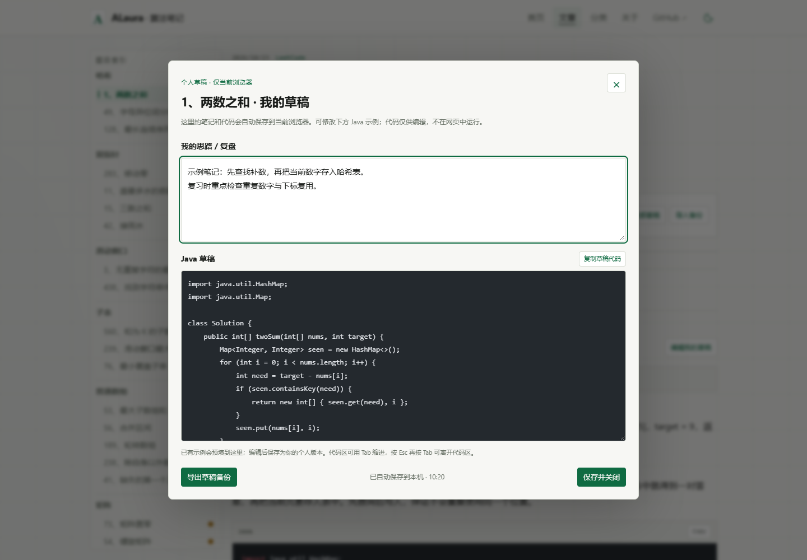
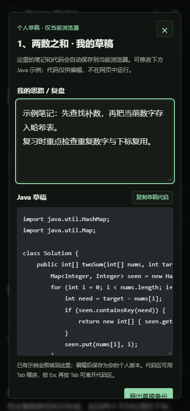

# 个人草稿：在网页里写笔记、修改 Java

所有 100 道题都提供“编辑我的草稿”按钮，包含已有题解和待补充题目。

## 使用方式

1. 打开 [Hot 100 长文](https://alaura-chi.github.io/hot100-blog/posts/hot_100/)，找到一道题，点击“编辑我的草稿”。
2. 在“我的思路 / 复盘”写自己的笔记。Java 区会带入已发布示例，可以直接修改；没有示例的题目可从空白开始写。
3. 暂停输入后会自动保存；底部显示“已自动保存到本机”。“保存并关闭”会立即保存并返回题目。
4. 再次打开、刷新或关闭浏览器后，仍可在同一浏览器、同一网站继续编辑。题目下的“我的草稿”可展开预览。
5. 复制自己的代码请使用编辑器中的“复制草稿代码”；正文中的 Copy 复制的仍是公开示例。

草稿不会上传或发布；公开题解、Java 示例、题目顺序和个人练习状态不会被草稿改写。Java 编辑区不执行代码，也不代为提交力扣。

## 备份与恢复

- 顶部“导出全部草稿”下载 JSON 备份，包含所有题目的笔记与 Java。保存失败时，也可从编辑器内部“导出草稿备份”保留最新输入。
- “导入备份”选文件后先显示将导入几题、替换几题，点击“确认导入”才生效；取消不会修改草稿。
- 导入只替换备份包含的题目，其他题目保留。错误格式、重复题号、未知题目和超长字段会在写入前被拒绝。
- 换浏览器或设备时，可以手动导出后再导入；没有自动跨设备同步。

清理网站数据或使用无痕窗口可能丢失浏览器中的草稿。线上网站与 localhost 预览分别保存，不会自动互相读取。重要内容请导出备份。

## 保存异常与冲突

存储禁用或空间不足时，页面明确提示“未能保存到本机”。此时输入暂留在当前页面，可继续编辑、复制和导出；刷新前请备份。

多个标签页同时修改同一道题时，不会在正在编辑的窗口直接覆盖输入，而是提示选择“使用另一标签页版本”或“保留我的版本”。也可以先导出当前输入再决定。

## 键盘与手机

- 使用 Tab 可到达“编辑我的草稿”，Enter 打开；关闭后焦点返回原按钮。
- Java 编辑区按 Tab 插入四个空格；按 Esc 后再按 Tab 可离开编辑区，再次 Esc 可关闭窗口。
- 手机使用同样入口，编辑窗口内部可上下滚动；长代码在代码区内滚动。

## 验收记录

`checks/drafts-qa.json` 记录 17 项独立浏览器测试：100 个入口、Java 预填、刷新与立即关闭保存、题目隔离、空代码保留、导入取消及恢复、错误备份保护、输入按纯文本呈现、键盘离开、多标签页冲突、存储禁用、配额失败和导出保底。测试使用隔离的浏览器数据，不接触用户已有草稿。

